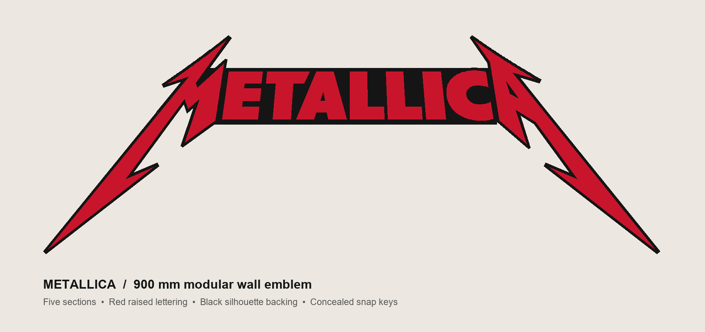

# Metallica modular wall emblem

A 900 × 320 mm wall emblem split into five printable sections for a Bambu P1S build plate. The pieces use concealed rear keys. Three key tolerances and a small fit test let the maker choose a fit before printing the full sign.

## What this project demonstrates

- Turning a large visual concept into five printable parts with repeatable alignment.
- Designing and checking snap key variants, geometry, and assembly maps.
- Preparing black and red Bambu Studio plates and a faster three plate layout.
- Comparing slicer estimates: the faster layout is estimated at 5 h 21 min and 186 g versus 6 h 57 min and 235.3 g for the original layout. These are estimates, not measured print results.

## AI-assisted workflow

The project guide identifies Higgsfield 3D Jutsu as part of the design workflow. The repository also includes an editable Blender model, a Blender build script, generated STL geometry, Bambu Studio projects, mesh validation, and slicing reports. This is an example of using AI tools alongside conventional modeling, fabrication, and verification tools. The files document the process; they do not establish that a physical print was completed.

## Explore the files

- [Fast print guide](FAST_PRINT/README.txt) and [illustrated assembly guide](FAST_PRINT/START_HERE.html)
- [Fast Bambu plates](FAST_PRINT/) — fit test, three production plates, and alternate key fits
- [Original Bambu plates](Bambu_Plates/) — individual sections and key variants
- [STL parts](STL/) and [editable Blender source](Metallica_900mm.blend)
- [Design preview](Design_preview.png), [front map](Front_assembly_map.png), and [rear map](Rear_assembly_map.png)
- [Mesh validation](Source/validation_report.json) and [slicer comparison](FAST_PRINT/Details/comparison.json)

**Status:** Digital geometry checks and slicing completed. Physical snap fit, print quality, and wall mounting still need testing. Re-slice for your own printer, build plate, and filament before use.

**Attribution:** Unofficial fan project based on the Metallica wordmark. The underlying band name and logo belong to their respective rights holders. Inclusion here is for portfolio documentation and does not claim endorsement or transfer rights to the source artwork.
