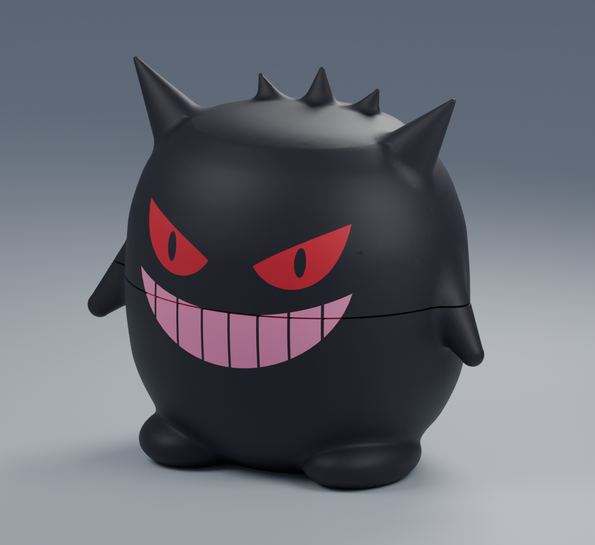
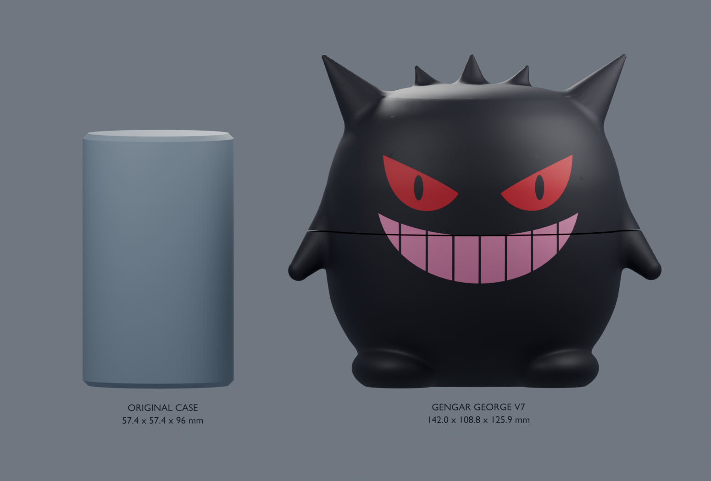
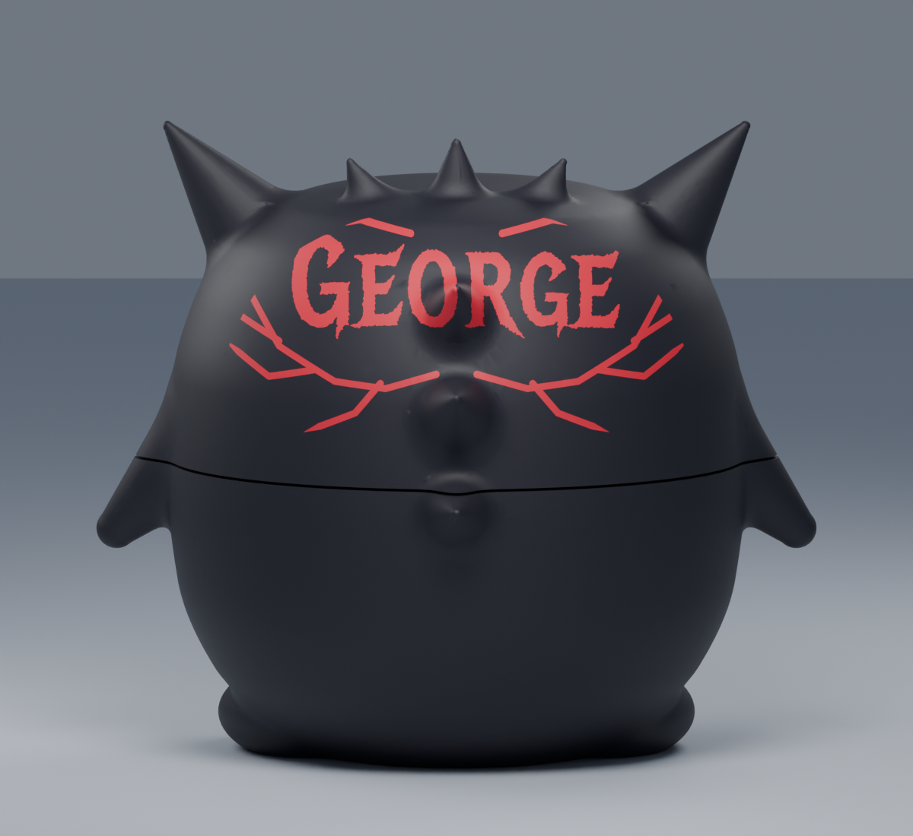

# GengarPuffco - George V7

A clean Gengar-inspired sculpt rebuilt from online visual references around the complete original Puffco case. The exterior has one rounded body, smoothly blended ears and short limbs, rear spikes, and crisp curved eyes and grin. The upper half twists off at the middle seam, with a small screw-on cup recessed underneath.

This replaces the stretched bowl mesh used in earlier revisions. The new exterior is generated from smooth implicit surfaces; the face uses Bezier outlines and matching color volumes. References and construction notes are in [DESIGN_REFERENCES.md](DESIGN_REFERENCES.md). The original bowl file remains archived in `Foundations` but does not generate this exterior.

| Assembly | Width x depth x height |
|---|---|
| Complete original foundation | 57.4 x 57.4 x 96.0 mm |
| **Gengar George V7** | **142.0 x 108.8 x 125.9 mm** |
| Previous Girth V5 | 131.1 x 110.1 x 118.0 mm |

The extra height is in the pointed ears and crown spikes. The case interior, its rigid placement, the original threads, and the small underside cup retain their previous dimensions. The main body closes smoothly over the original lid. The generator limits the assembly to 148 x 122 x 129 mm.

The rear head now carries **George** in Metal Mania lettering with custom mirrored cybersigilism-inspired thorn details, printed in red. The artwork is flush and uses aligned AMS color volumes; the sculpt dimensions, foundation, and threads are unchanged.

## Closures and color

- **Upper half:** turns counterclockwise viewed from above on the original approximately 2.5 mm-pitch case thread. The nominal horizontal seam is 0.6 mm wide and crosses the grin near the middle of the character.
- **Underside cup:** a separate 2.5 mm-pitch thread. Turn counterclockwise viewed from underneath. The exposed bottom has scallops for grip.
- **Compartment:** 32 mm clear diameter x 10 mm clear depth; 2 mm floor; 12 mm cup height. It is a small compartment, not the previous full-width deep cup. Any jar or liner needs to fit inside those dimensions.
- **Colors:** black character, red eyes and rear wordmark, pink grin, red underside cup. The grin crosses the opening seam, so both body and head projects contain color regions.
- The original head thread has no new alignment stop. The final tightened face alignment requires a physical test.

## Print files

Open the native files **as projects** in Bambu Studio and keep their saved orientation and 100% scale:

1. `Print/P1S/01_BODY_EXACT_FOUNDATION_P1S.3mf` - lower half, original case base, black/pink grin regions, recessed cup socket.
2. `Print/P1S/02_GENGAR_HEAD_COLOR_P1S.3mf` - upper half, original case lid, black/red/pink regions. Prints inverted, with the original cavity upward.
3. `Print/P1S/03_BOTTOM_CAP_P1S.3mf` - small red underside cup.

For an all-black character, pair `01b_BODY_SINGLE_COLOR_P1S.3mf` with `02b_GENGAR_HEAD_SINGLE_COLOR_P1S.3mf`, plus the red cup. The colored regions are aligned multipart AMS regions, not snap-in inserts.

`Print/Geometry` contains exact unsliced 3MFs. `ASSEMBLED_VIEW_ONLY.3mf` is for inspection, not print-in-place. The editable Blender file and all current previews represent George V7; earlier revisions remain in Git history.

The included benchmark is P1S / 0.4 mm / textured PEI / 0.20 mm layers / four walls / 8% gyroid / zero XY compensation. Generic PLA uses 220 C nozzle, 55 C bed and 12 mm3/s maximum flow. Choose calibrated profiles for your actual spools and re-slice. Inspect supports and their removal from the lower opening. Estimates are in [PRINT_ESTIMATES.md](PRINT_ESTIMATES.md). No printer job has been sent.

## Fit and checks

The previously printed Venom was reported too tight. Its source audit found no scale error, so a physical cause was not established. This version preserves the original case base, lid, device cavity, slots and mating threads rather than scaling the functional geometry to accommodate the character.

If the original foundation has not already been printed successfully, use the included `00a_ORIGINAL_BASE_ONLY_P1S.3mf` and `00b_ORIGINAL_LID_ONLY_P1S.3mf` first. If it already fits, do not repeat that test. Check the new lower half and cup before committing to the colored head. Do not scale the whole project to adjust fit.

Geometry checks cover closed new surfaces, consistent winding, positive volume, and one connected combined solid for each opening part. The original source vertices and topology are preserved under rigid placement in geometry exports. Native projects are checked for source precision, triangle counts, unit scale and zero XY compensation.

Both screw-opening paths are sampled every 5 degrees through four turns, followed by head-lift and storage-exit checks. Added geometry is checked against free space inside the exact original case envelopes. Reports are in `Reports/`. These digital checks do not establish physical fit, face alignment, sealing, durability or support-removal quality.

In the section preview, green highlights the unchanged original case for clarity; it is not an additional filament color.

## Sources and regeneration

`CAD/Gengar_Compact_EDITABLE.blend` contains the current mesh and studio scene. `sculpt_character.py` generates and caches the decorative exterior. Run `build_gengar.py`, `export_prints.py`, `render_gengar.py`, and `render_section.py`. Run `slice_p1s.py <path-to-bambu-studio.exe>` for native projects, then `verify_native.py`. Dependencies are in `CAD/requirements.txt`.

Original complete case: **ROADBLOCK**, "Core Case for Puffco Proxy Core," embedded MakerWorld Exclusive License. Gengar bowl: **tom3Dmodel**, "Gengar pokemon Bowl," embedded Standard Digital File License. Original archives and metadata are retained in `Foundations`. This derivative does not assert additional redistribution rights.
