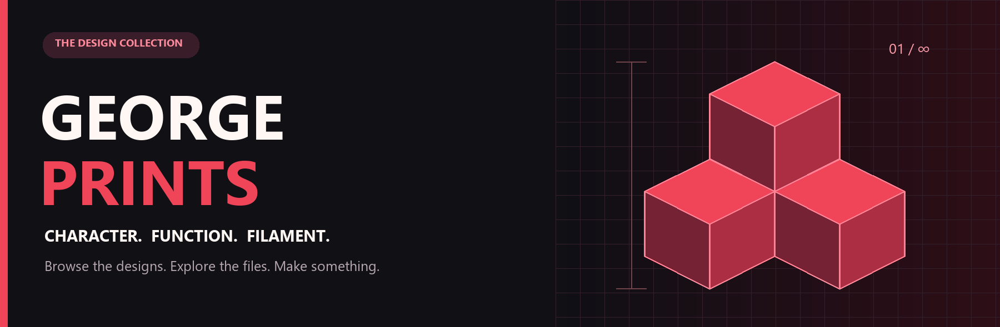
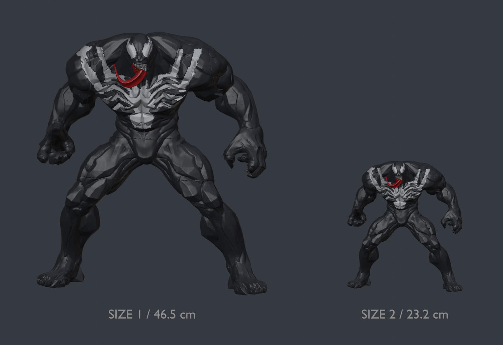
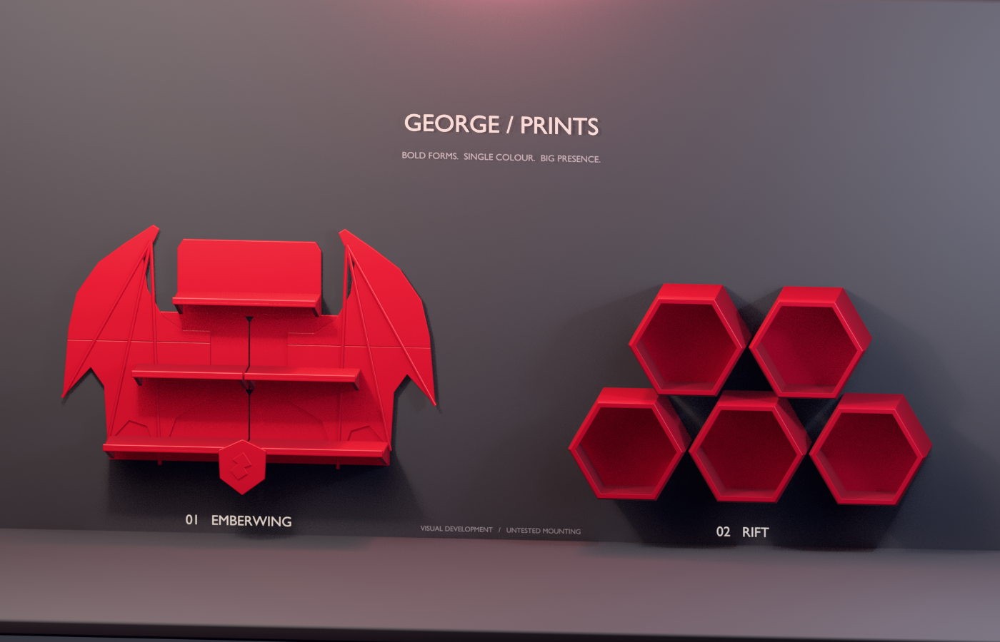
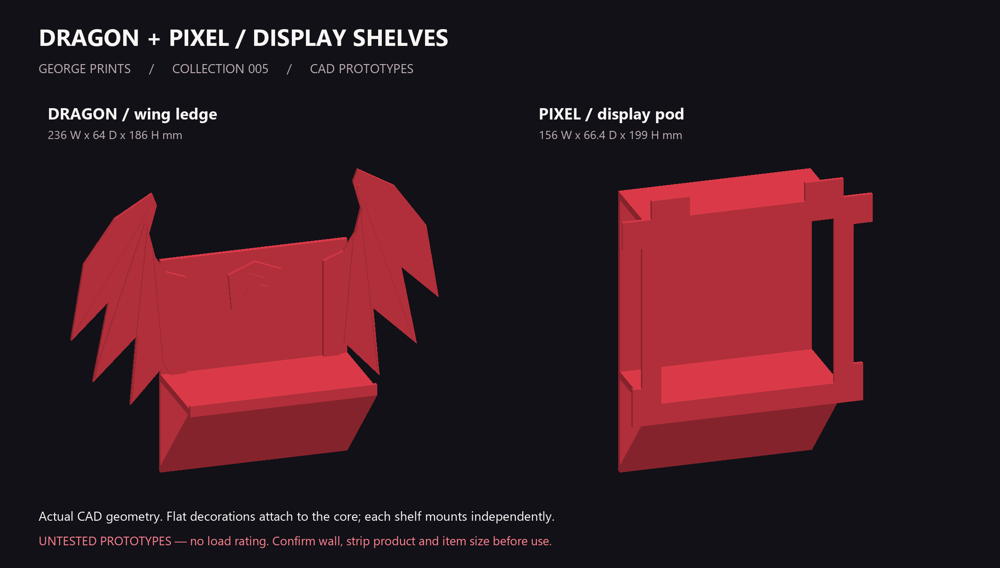
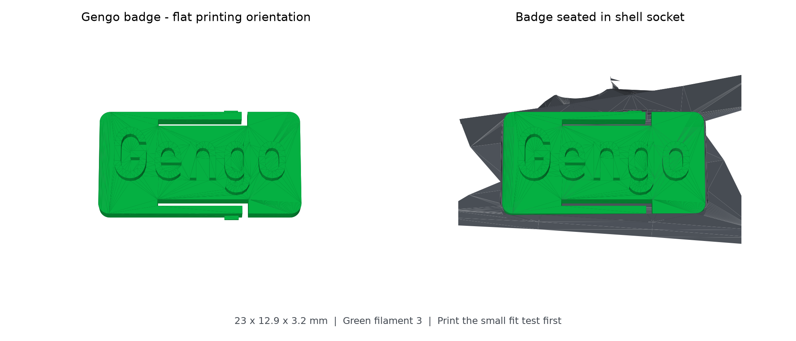
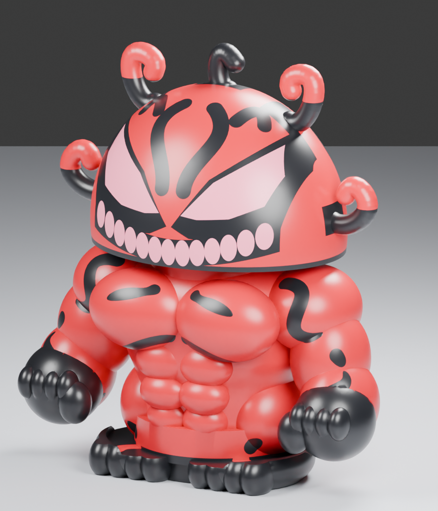
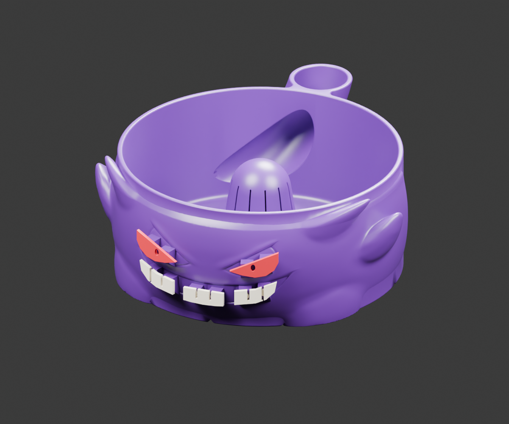
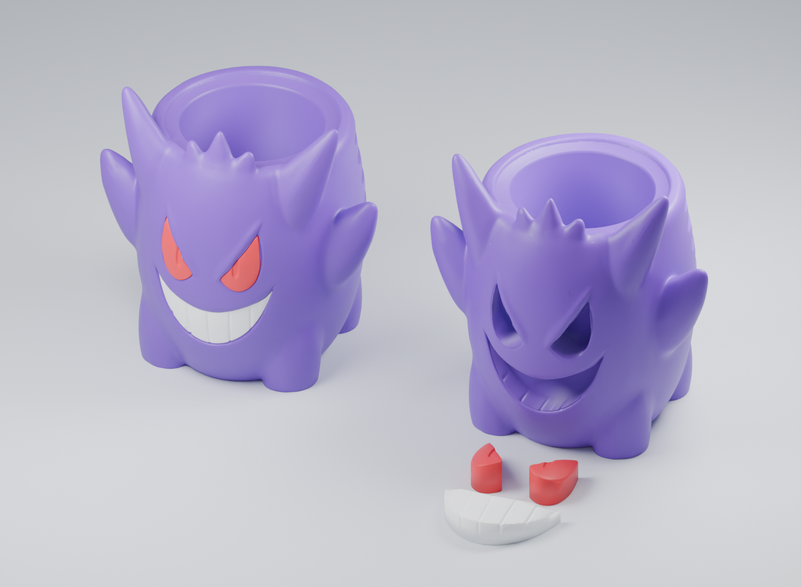

<strong>Character pieces. Useful objects. Designs worth making.</strong> 3D printing projects by George Dayoub, with a home for the files, the process, and your next print.

<a href="#the-collection">Browse the collection</a> · <a href="docs/GETTING_STARTED.md">Start printing</a> · <a href="docs/SUPPORT.md">Support my work</a> · <a href="https://github.com/gdayoub/george-Print-files/issues/new/choose">Share a make or idea</a>

## Portfolio: AI-assisted 3D design

I use AI tools to help turn ideas into editable models and printable projects, then document the geometry, slicer setup, and checks so someone else can inspect the work. The [Metallica modular wall emblem](Desktop-Prints/metallica%20logo/PORTFOLIO.md) is one example: a five section design with fit tests, alternate snap keys, an editable Blender model, and Bambu Studio plates. Its faster layout is estimated to save 1 h 36 min and 49.3 g of filament compared with the original layout. Those are slicer estimates; the physical build remains untested.

These pages distinguish CAD renders and digital checks from completed physical prints. Fan projects are unofficial, and source artwork retains its original rights.

## Fresh from the workbench

### Venom / two statue sizes

Whole arms and legs, keyed glue assembly, and lightweight P1S/P2S projects. Choose the large 46.5 cm build, the economical 23.2 cm build, or the small AMS option with integrated white details.

**Digitally checked and sliced · Physical fit untested · Private backup; source redistribution permission unverified**

[**Files, estimates and assembly →**](prints/venom-muscular-statue/) · [Source credit and license](prints/venom-muscular-statue/CREDITS.md)

### Emberwing + Rift / new design direction

Sweeping dragon wings and three display tiers, or five chunky hexagonal pods in a stepped arrangement. Bigger silhouettes, softened edges, and one-colour character. Built as editable 3D models in Higgsfield.

**11 prototype STLs · Editable Blender + GLB · Mesh checked · Physical testing pending**

[**See the new models →**](prints/emberwing-rift-concepts/) · [Explore in Higgsfield](https://higgsfield.ai/3d-jutsu/1bd91395-c562-475f-ad62-cc479b26331c)

## Earlier shelf prototypes

### Dragon + Pixel Display Shelves

A little fantasy, a little arcade, and a place for the things you make. Choose a winged display ledge, a blocky pixel pod, or the plain ledge for the simplest print. Separate flat decorations keep the colour changes optional.

**PLA · Bambu P1S · Seven STL parts · Editable source · Prototype**

[**Explore the shelves →**](prints/dragon-pixel-shelves/) · [Download the prototype kit](prints/dragon-pixel-shelves/downloads/dragon-pixel-shelves-prototype.zip?raw=true) · [Printing & assembly](prints/dragon-pixel-shelves/docs/PRINTING_ASSEMBLY.md)

> The shelf meshes are checked, but they are not yet sliced or physically tested. Adhesive mounting on textured painted walls remains unresolved; no working load is assigned.

## The collection

### Metallica / modular wall emblem

A 900 mm, five section wall sign with concealed snap keys, fit test, assembly maps, STL parts, editable Blender source, and Bambu Studio projects. The faster plate layout is documented alongside the original.

**Digitally checked and sliced · Physical print and mounting untested · Unofficial fan project**

[**Explore the project →**](Desktop-Prints/metallica%20logo/PORTFOLIO.md)

<table>
<tr>
<td width="50%" valign="top">

<h3>Thorn / Gengo</h3>

A separate green badge, matching recessed socket, and four single-colour P1S plates. Start with the fit test.

<strong>CAD checked + sliced</strong> Physical snap fit untested.

<a href="prints/d2-thorn-gengo/">Open project →</a>
</td>
<td width="50%" valign="top">

<h3>Venom / V4</h3>

A Puffco Core case with matching lid, separate jar storage, and full-colour or single-colour P1S projects.

<strong>CAD checked + sliced</strong> Physical fit untested.

<a href="prints/venom-core-case/">Open project →</a>
</td>
</tr>
<tr>
<td width="50%" valign="top">

<h3>Gengar / FlowWash</h3>

A socketed bowl with separate snap-in eyes and teeth. Includes P1S projects, STL geometry, editable Blender source, and a fit test.

<strong>CAD checked + sliced</strong> Physical fit untested.

<a href="prints/gengar-flowwash-snap-kit/">Open project →</a>
</td>
<td width="50%" valign="top">

<h3>Gengar / Can Holder</h3>

A tall holder for a classic 12 oz soda can, with separate red eyes and a white grin. Three colour-specific jobs avoid repeated filament swaps.

<strong>Tested by George, as reported</strong> Public files await source-license clarification.

<a href="prints/gengar-can-holder/">Open project →</a>
</td>
</tr>
</table>

## Pick a design. Check the notes. Make it yours.

1. **Open the project page.** Check its dimensions, material, and testing status.
2. **Download the recommended version.** A `.3mf` may include a slicer setup; an `.stl` is geometry that still needs slicing. Review either before printing.
3. **Print the fit test first, when supplied.** Follow the project’s orientation, printing, and assembly notes.
4. **Show the result.** Share a photo, your printer and filament, and anything you changed. Useful feedback helps the next maker.

[First-print guide](docs/GETTING_STARTED.md) · [What the status labels mean](docs/GETTING_STARTED.md#understanding-project-status)

## Like what you made?

If a design earns a place on your desk or shelf, a star here, a make photo, or a thoughtful print report means a lot. Once a model is published on **MakerWorld**, you can also consider a **Boost** on its listing if you enjoy the work and have one available.

**MakerWorld profile and model links: coming soon.** This gallery does not currently claim a published listing. Support is always optional.

[**Ways to support my work →**](docs/SUPPORT.md)

## Behind the prints

The curated pages keep each project’s previews, recommended files, instructions, credits, and validation together. [Browse the catalog](catalog.json) or use the [project template](templates/print/README.md) when adding the next design.

<strong>Original backups & earlier packages</strong>

The September 26, 2026 desktop snapshots retain their original names and structure:

- [Desktop Prints](Desktop-Prints/) — 229 files.
- [Archived Desktop Venom packages](Desktop-Prints-Archive/) — 117 files.
- [SHA-256 inventory](desktop-prints-manifest.json) — all 346 snapshot files.
- [Earlier Gengar package](GengarPuffco/) and [Red Gengar package](RedGengarPuffy/).

These are historical source collections, not a recommendation to print every version. The snapshots do not imply physical testing or redistribution clearance. Start with the curated pages above.

Licensing and attribution are recorded per project. Fan-inspired projects are unofficial; no blanket license is applied to third-party designs. The repository’s existing visibility is unchanged.
