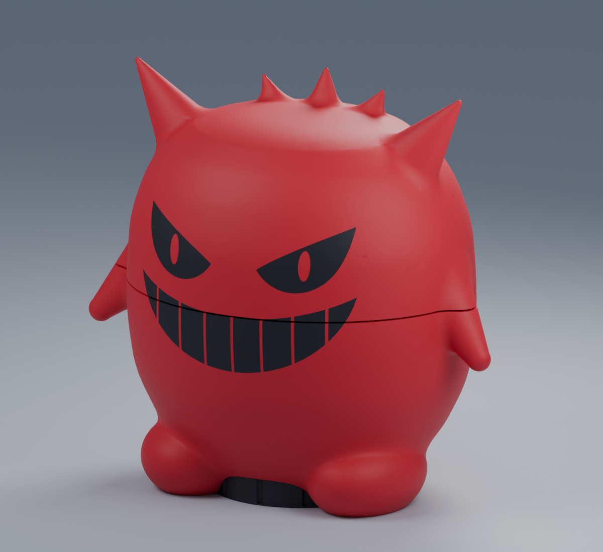
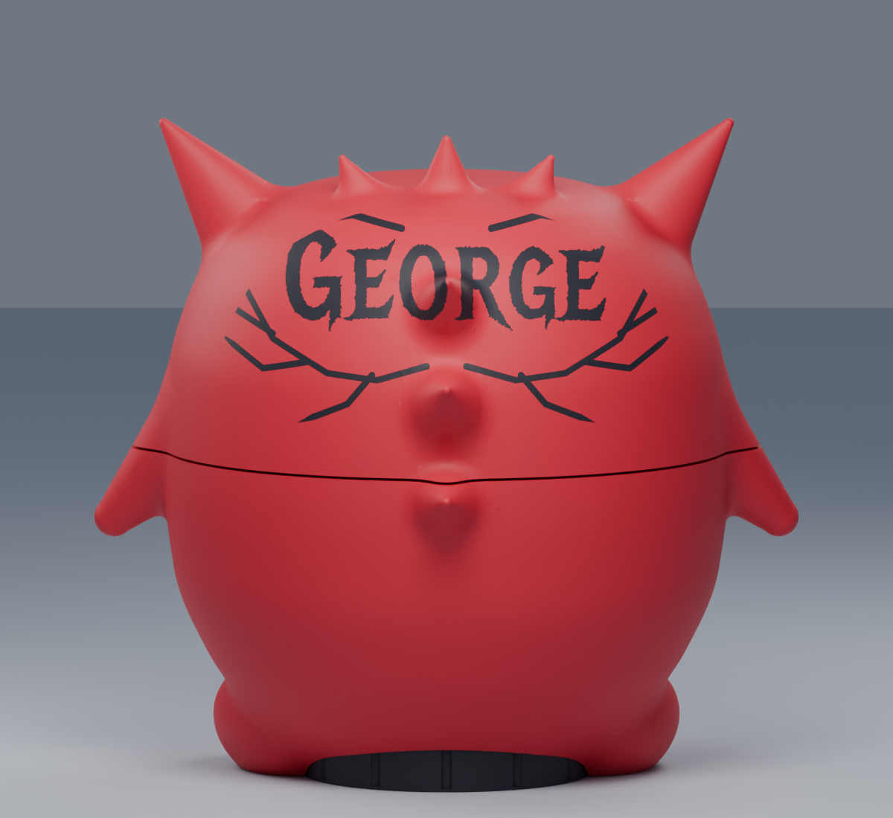

# RedGengarPuffy

Two-color AMS edition of GengarPuffco Wide Holder V8.

The main character and exact original case foundation print red. The eyes, segmented grin, rear **George** artwork, and enlarged dab holder print black. The model geometry, device cavity, twist-off head, 57.4 mm-wide holder, 19.05 mm holder height, and 50.6 x 17.05 mm clear storage space are unchanged from V8.

## AMS print projects

Open these native projects separately in Bambu Studio and retain their saved orientation and 100% scale:

1. `P1S/01_RED_BODY_AMS_P1S.3mf`
2. `P1S/02_RED_HEAD_AMS_P1S.3mf`
3. `P1S/03_BLACK_DAB_HOLDER_P1S.3mf`

Load red in AMS slot 1 and black in slot 2, or confirm Bambu Studio maps those colors to the slots where those filaments are loaded. The body and head use automatic tree supports and prime towers. Remove supports before assembly.

`Geometry/ASSEMBLED_RED_BLACK_VIEW_ONLY.3mf` is for visual inspection and is not a print-in-place project. The three individual Geometry files are unsliced alternatives.

The projects use the existing P1S baseline: 0.4 mm nozzle, textured PEI plate, 0.20 mm layers, four walls, 8% gyroid infill, and zero XY compensation. The saved profiles use generic PLA values; select calibrated profiles for the actual red and black spools before printing.

The controlled slicer estimate for all three pieces is **21 h 26 m** and **423.3 g** including supports, prime towers, and purge material. The estimate uses about **341.9 g red** and **81.4 g black**. The body has 90 color changes and the head has 248.

These files are digitally sliced and checked, but physical fit and final tightened head alignment still require a test print. The V8 body and enlarged holder are a matched pair.

Regenerate with `python build_ams_variant.py <path-to-bambu-studio.exe>` after rebuilding the source GengarPuffco project. `render_red_variant.py` creates the color preview from the actual CAD meshes.

Validation details are in `Reports/native_verification.json`. All three native archives sliced without warnings or mesh repairs; the original foundation remains at unit scale and within 0.00001 mm of its exact source vertices after rigid placement.
