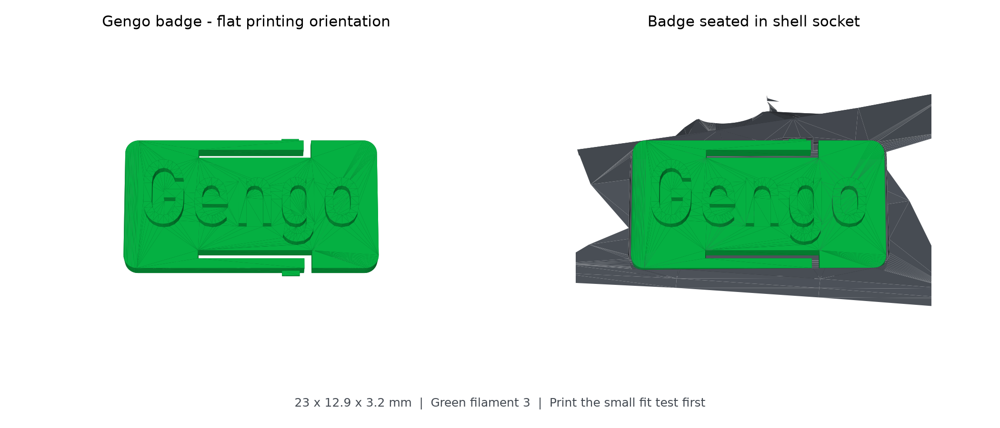
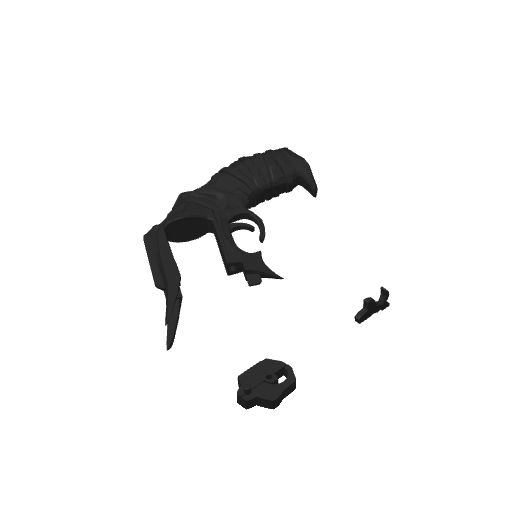
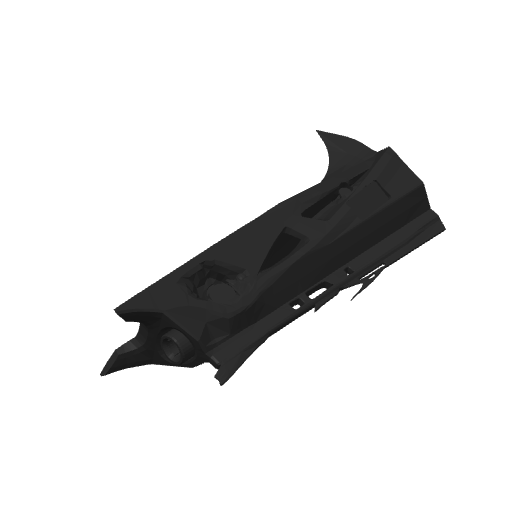

# Destiny 2 Thorn — Gengo click-in badge

[← Print gallery](../../README.md)

A decorative Thorn cosplay prop with a separate green **Gengo** badge and a matching recessed socket in the black shell. The badge is independently selectable in Bambu Studio. The receiver/handle and shell now lie on their broad sides, with the Gengo socket facing upward. All four plates use one colour each, eliminating repeated filament swaps and the prime tower.

*CAD render of the actual meshes; physical snap fit has not been print-tested.*

## Download and print

- **[Complete four-plate Bambu Studio project](D2_Thorn_Gengo_FLAT_low_support.3mf)** — recommended project.
- **[Print the small fit test first](Gengo_fit_test_first.3mf)** — separate black socket and green badge plates, about 24 minutes and 3.3 g combined.
- [Badge STL](Gengo_click_in_badge.stl) · [Socket test STL](Gengo_socket_fit_test.stl).
- [Printing and assembly instructions](READ_ME.txt).
- [Original supplied project](source/D2_thorn_agent_before.3mf).

| Plate | Contents | Filament |
| --- | --- | --- |
| 1 | Cartridge | 2 — gold |
| 2 | Handle and fittings | 1 — black |
| 3 | Four green details and Gengo badge | 3 — green |
| 4 | Shell with recessed click-in socket | 1 — black |

The badge is approximately **23 × 12.9 × 3.2 mm** and prints flat, with its text facing upward. It uses 100% infill, three walls, no supports, and no brim. Saved settings target a **Bambu P1S, 0.4 mm nozzle, PLA, and 0.16 mm layers**. Ordinary startup purging still occurs.

## Assembly

Let the parts cool. Clear the badge's two long slots and remove debris or first-layer flare. Align the badge with the socket and press evenly on its ends so its side tabs flex and engage the catches. Check the small sample first; do not force a tight fit. Clear any support remnants from the full shell's recess before assembly. Leave mating surfaces unpainted until fit is checked.

The sample uses the same socket shape, but prints with its recess upward; the full shell now rests on its broad side. Those different orientations can affect fit and surface finish.

## Validation and estimates

All four project plates and both test plates sliced successfully in Bambu Studio **02.08.02.61**, with **zero filament changes**. The badge is one connected watertight mesh; the modified shell and socket sample are watertight. The seated badge has no mesh collision with the shell. Nominal entrance clearance is 0.25 mm per side, with approximately 0.20 mm snap-tab deflection.

| Black plates 2 + 4 | Support material | Total filament | Estimated time |
| --- | --- | --- | --- |
| Previous upright Gengo version | 38.21 g | 203.11 g | 8 h 38 m |
| Flat version | 25.11 g | 187.84 g | 9 h 15 m |

The flat version uses about **34% less support and 15.3 g less total filament** across the two black plates. Its sideways shell prints more slowly, so their combined estimate is approximately **37 minutes longer**. Support remains under curved details and overhangs. The handle uses snug normal supports with 4 mm base-pattern spacing; the shell retains automatic tree supports. Support interfaces remain enabled.

*Bambu Studio model previews of the new orientations; support geometry is not displayed in these thumbnails.*

All four plates were sliced successfully with zero filament changes. Plates 1 and 3 are unchanged. The receiver and grip remain grouped, and all input mesh files were preserved byte-for-byte. See the [orientation comparison](validation/flat_orientation_comparison.json) and [complete slicing report](validation/flat_slicing_report.json).

The [previous upright project](source/D2_Thorn_Gengo_previous_upright.3mf) remains available for comparison. These are slicer estimates, not measured print results. **Physical printing and snap fit remain untested.**

The source lettering said **Gango**; this version uses **Gengo**, matching the requested spelling.

## Credits and licensing

See [CREDITS.md](CREDITS.md). Source attribution and licence metadata are retained in the 3MF. No blanket repository licence is applied to the third-party model.
