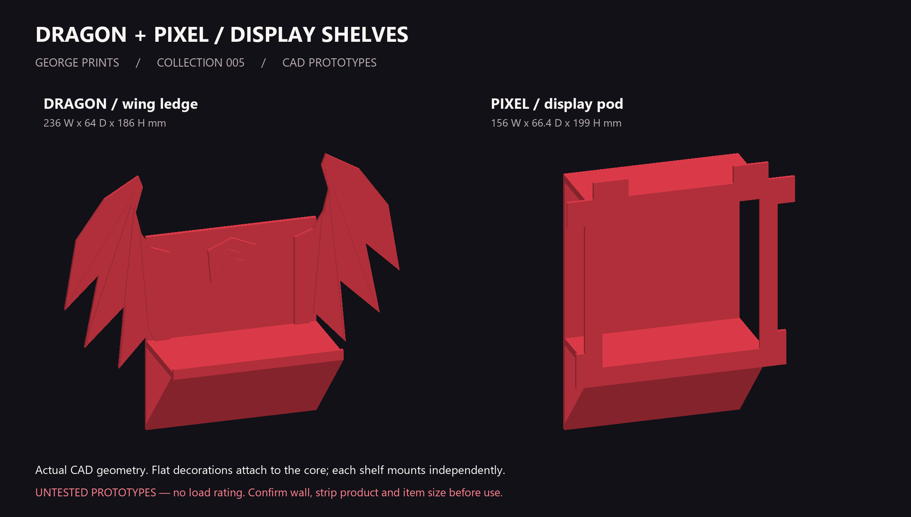
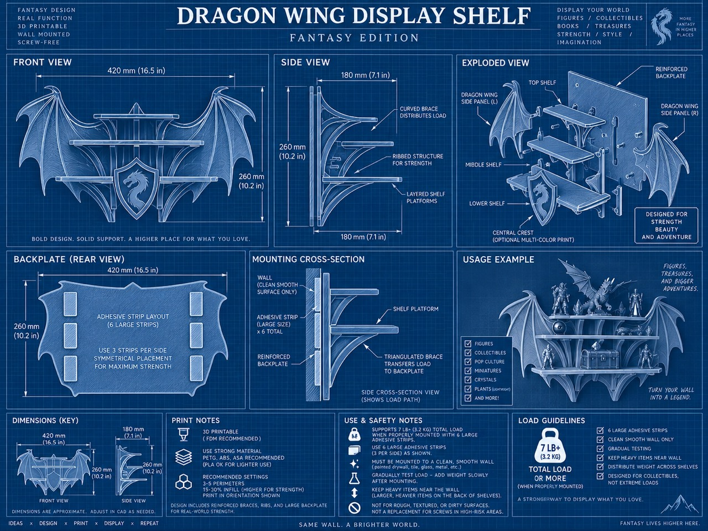
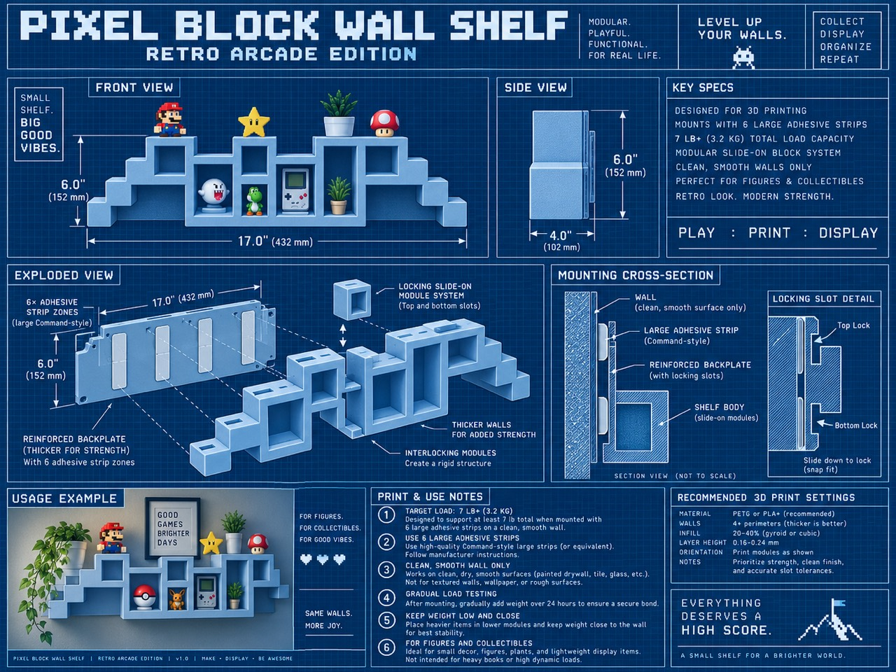

[← George Prints](../../README.md) · [Printing & assembly](docs/PRINTING_ASSEMBLY.md) · [Support the creator](../../docs/SUPPORT.md)

# Dragon + Pixel Display Shelves

**A place for the things you make.** Winged fantasy details and chunky arcade shapes, built around shallow single-colour PLA cores. Print the decorations in the same filament, give them an accent colour, or leave them off for a simpler ledge.

**Version 0.1.0 · CAD prototype · Bambu P1S · 0.4 mm nozzle · Millimetres**

> **Before printing:** These are development prototypes, not tested wall hardware. The meshes passed digital checks, but the parts have not been sliced or physically printed. Adhesive mounting for the intended textured painted wall remains unresolved. No working load is assigned.

[**Download the prototype kit →**](https://github.com/gdayoub/george-Print-files/raw/refs/heads/main/prints/dragon-pixel-shelves/downloads/dragon-pixel-shelves-prototype.zip) · [Individual STLs](files/stl/) · [Editable source](source/) · [Full build guide](docs/PRINTING_ASSEMBLY.md)

## Choose your version

| Version | Overall W × D × H | Parts | Why choose it? |
|---|---|---|---|
| **Plain ledge** | 120 × 64 × 140 mm | `01` | Fewest parts and least material. |
| **Dragon ledge** | 236 × 64 × 186 mm | `01`, both `03`, optional `04` | A wing silhouette with flat decorative pieces. |
| **Pixel pod** | 156 × 66.4 × 199 mm | `02`, `05` | An arcade-style opening; repeat as independent modules. |

The plain and dragon decks have 120 × 58.4 mm of space behind the front lip. The pixel pod has a 108 × 106 mm front opening. Depths exclude adhesive thickness. Check your object’s base before printing; not every mouse will fit these shallow decks.

## What to download

| File | Quantity | Purpose |
|---|---|---|
| [00 — Surface coupon](files/stl/00_adhesive_surface_coupon_SIDE_PRINT.stl) | 1 first | Check strip dimensions and print finish; does not prove mounting strength. |
| [01 — Ledge core](files/stl/01_ledge_core_SIDE_PRINT.stl) | 1 per plain/dragon shelf | Structural body with diagonal underside shell. |
| [02 — Pixel core](files/stl/02_pixel_cubby_core_SIDE_PRINT.stl) | 1 per pixel shelf | Structural body with upper deck. |
| [03 — Left wing](files/stl/03_dragon_wing_L_FLAT.stl) / [right wing](files/stl/03_dragon_wing_R_FLAT.stl) | 1 each | Nonstructural decorations. |
| [04 — Crest](files/stl/04_dragon_crest_FLAT.stl) | Optional | Centre emblem. |
| [05 — Pixel frame](files/stl/05_pixel_frame_FLAT.stl) | 1 per pixel shelf | Decorative front frame. |

All STLs are already oriented for the intended print. No printer-ready G-code or verified 3MF profile is supplied.

## Quick print notes

Use your actual PLA and plate profiles in Bambu Studio. Start with **0.28 mm layers, four walls, four top/bottom layers, and 10–15% gyroid infill** for the core. These are proposed settings, not a tested profile. Keep cores on their supplied side orientation, decorations flat, and inspect the slice before printing without supports. A 5 mm brim is a starting point for the core’s narrow footprint.

The thin core shell is mostly walls, so lowering infill alone saves little. Choosing the plain ledge saves the most material. Avoid scaling blindly because wall thickness and mounting area also change.

## Assembly at a glance

1. Check the coupon and one core before printing a full set.
2. Dry-fit decorations. Wings and crest sit on the **room-facing front of the backplate**; the pixel frame sits against the front deck edges.
3. Glue only those decorative contact areas with a PLA-compatible adhesive, following its curing instructions.
4. Keep the wall-contact face clear. Finalise and verify mounting before loading a shelf.

[Detailed placement measurements, mounting research and print settings →](docs/PRINTING_ASSEMBLY.md)

## Design notes & test status

The 64 mm body depth limits leverage compared with the 180 mm-deep dragon concept. A tall backplate and diagonal shell form a continuous load path. These features do not establish adhesive capacity.

- **Checked:** seven watertight STL meshes, positive volume, one connected part per STL, and individual dimensions within the P1S build volume.
- **Not physically checked:** print quality, load, paint adhesion, long-term creep, or mounting reliability.
- **Current wall:** textured paint. Standard smooth-wall strip assumptions do not apply.

[Validation](validation/mesh_validation.json) · [Version history](docs/CHANGELOG.md) · [Credits](CREDITS.md)

<strong>Original inspiration images</strong>

The supplied blueprints are style references. Their load claims were not adopted as verified specifications.

[Earlier neutral-colour preview](images/design_preview_original.png)

## Made one? I’d love to see it.

Share a photo and your settings in a [print report](https://github.com/gdayoub/george-Print-files/issues/new?template=print-report.yml). If you enjoy the design, star this repo and consider a **Boost** once its MakerWorld listing is live. Support is optional and appreciated.

**MakerWorld listing: not published yet.** [Publication draft and next steps](docs/MAKERWORLD.md).
