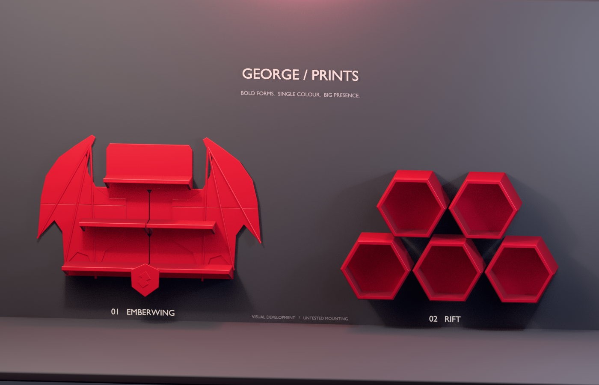
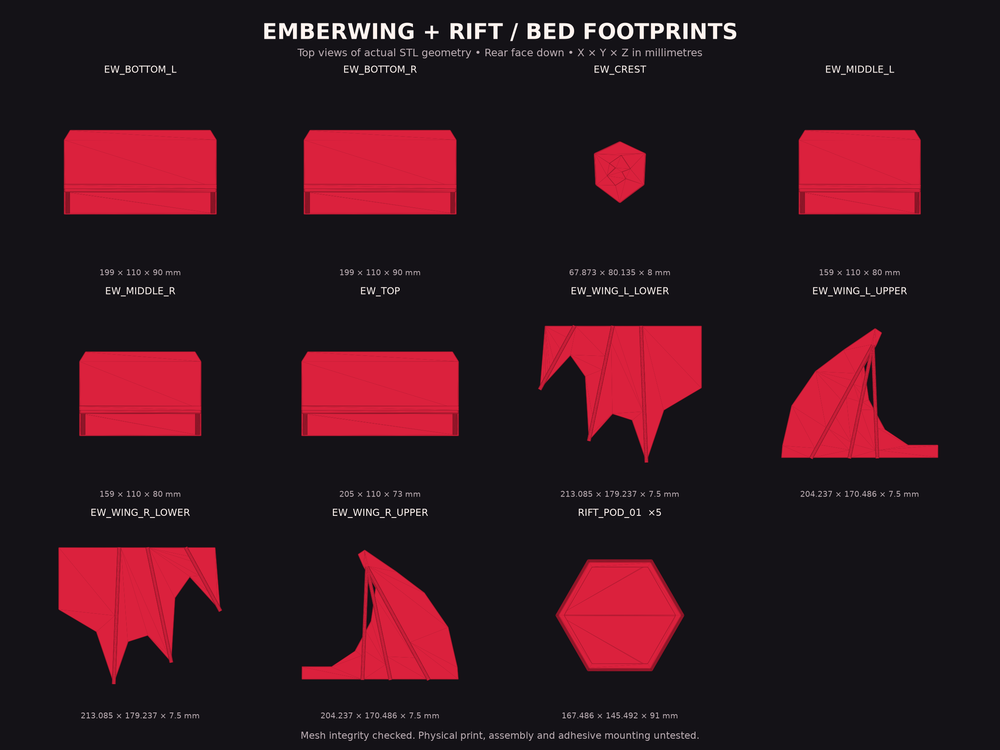

[← George Prints](../../README.md) · [Earlier shelf prototypes](../dragon-pixel-shelves/) · [Support the work](../../docs/SUPPORT.md)

# Emberwing + Rift

**Bigger shapes. More presence. One colour.** Two original shelf designs built in Higgsfield 3D Jutsu, with editable models and experimental STL parts.

[**Explore the interactive 3D scene →**](https://higgsfield.ai/3d-jutsu/1bd91395-c562-475f-ad62-cc479b26331c) · [Editable Blender scene](models/emberwing-rift.blend) · [Portable GLB scene](models/emberwing-rift.glb)

## 01 / Emberwing

[**Download the prototype bundle →**](downloads/emberwing-rift-prototypes.zip?raw=true) · [Print guide](docs/PRINTING.md) · [STL files](files/stl/)

**11 unique STLs · PLA / P1S target · Mesh checked · Unsliced and physically untested**

A wide three-tier display with sweeping dragon wings, raised wing fingers, softened ledge edges and a geometric crest. The wings do most of the visual work, so the design does not depend on tiny scales, fragile spikes or multiple filament colours.

The wings split into upper/lower sections and the wider ledges into left/right modules. All ten exported parts fit individually within the P1S build volume. The assembled silhouette is about **536 mm wide × 371 mm high × 98 mm deep**. Decoration joints and wall mounting still require physical development.

## 02 / Rift

Five staggered hexagonal display pods form a broad, sculptural wall arrangement. Deep front chamfers and repeated clean geometry create the look. Each pod is a named module with a flat back, an open front and substantial rim.

One pod measures approximately **167.5 × 145.5 × 91 mm**. Print the same STL five times for the pictured **511 × 298 mm** arrangement, or start with one. Each pod needs its own support; they do not share structural loads. Tapering the inner frame reduced geometric solid volume by **53%** from the first version while preserving the outside dimensions. This is not a measured filament or print-time saving.

## What is included

| Folder | Contents |
|---|---|
| `images/` | Renders made from the actual scene geometry. |
| `models/` | Editable Blender, presentation GLB and two model-only GLBs. |
| `files/stl/` | Ten Emberwing parts and one repeatable Rift pod, in millimetres. |
| `downloads/` | A self-contained prototype bundle. |
| `source/` | Python that creates the scene in Higgsfield’s Blender worker. |
| `validation/` | Mesh checks, dimensions, hashes and Higgsfield provenance. |
| `docs/` | Print starting points, assembly notes and an unpublished listing draft. |

In Blender, the collections beginning `01 / EMBERWING` and `02 / RIFT` contain the models. `00 / STUDIO / do not print` contains the backdrop, text, lights and camera. Objects carrying `part_id` identify candidate physical sections. Dimensions in the source scene are **metres**, not millimetres.

[Emberwing model-only GLB](models/emberwing-model-only.glb) · [Rift model-only GLB](models/rift-model-only.glb)

## Prototype status

The exported STLs consolidate intersecting components into single connected solids. All 11 distributed files pass watertightness, positive-volume, round-trip and bounding-box checks. The largest part dimension is **213.1 mm**. The Blender scene retains separate component meshes and modifiers for editing.

These are **unsliced, physically untested prototypes**, not verified print profiles. First layers, overhangs, assembly tolerances, sustained load and adhesive performance still need testing. Start with one module using the [print guide](docs/PRINTING.md).

Your wall is textured and painted. A reliable adhesive system has not been established, and neither design has a working-load rating. Enlarging the design changes its mass and leverage; it does not make the earlier adhesive proposal valid.

[Design and printing-development notes](docs/DESIGN.md)

## Follow the next iteration

The goal is a bold display that is practical to make in PLA on a Bambu P1S. Physical print photos, tested profiles and MakerWorld links will be added only when available. An [unpublished listing draft](docs/MAKERWORLD_DRAFT.md) is included for later. If you enjoy the direction, star the repo, suggest improvements, or consider a Boost when a finished model is published. Support is always optional.

Design direction by George Dayoub; scene modelling and documentation with Codex using Higgsfield 3D Jutsu. No external model mesh was imported. No blanket license is introduced for this repository.
