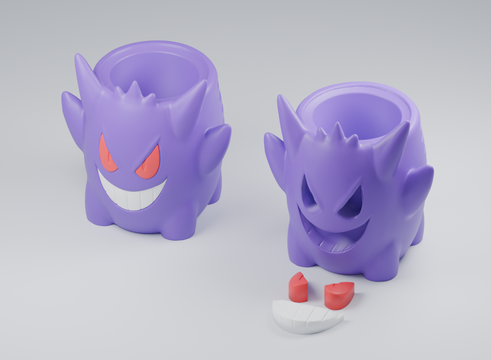

# Gengar soda can holder

[← George Print Files](../../README.md)

*Rendered preview. The left view shows assembly before adding black paint; the right shows the recesses and separate inserts.*

## The design

A Gengar-themed bowl adapted into a deep soda can holder. The tall character surrounds the pocket, with small finger recesses at the sides. Two red eyes and a connected white grin glue into the purple body.

The recommended version prints as **three single-color jobs**. No repeated color changes or prime towers are needed. An AMS is optional; filament can be changed between jobs.

## Files

The following files have been prepared locally. Public redistribution is pending clarification of the supplied source model's license; the names below are an inventory, not download links.

| Job | Color | Prepared files |
| --- | --- | --- |
| 01 · Body | Purple | `01_Purple_Body.3mf` and `.stl` |
| 02 · Two eyes | Red | `02_Red_Eyes.3mf` and `.stl` |
| 03 · Grin | White | `03_White_Grin.3mf` and `.stl` |

[Credits and release status](CREDITS.md)

## Dimensions

| Item | Size |
| --- | --- |
| Intended can | Standard 12 US fl oz / 355 mL |
| Can reference | About 66 mm diameter × 122.22 mm tall |
| Holder | About 142.64 × 119.82 × 144.97 mm |
| Can pocket | 69.2 mm diameter × 112 mm deep |
| Insert clearance | 0.25 mm per side and behind each insert |

Can reference: [Crown's standard 12 oz specification](https://www.crowncork.com/beverage-packaging/products/beverage-cans/12oz-355ml-standard).

## Printing and assembly

See [the print and assembly guide](docs/BUILD.md). Keep every part at **100% scale in millimeters**.

## Validation

George reports testing his version. Detailed test settings, photographs, and measured fit results have not yet been recorded in this repository.

Digital checks on the separate-insert files passed: closed solids, successful STL/3MF re-import, designed insert clearance, and a clear vertical insertion path for a 66.2 mm diameter can. Digital validation is not a guarantee of fit on every printer.

## Version notes

The current version retains the tall integrated character and smaller finger recesses. It replaces the earlier four-color print with separate face inserts. Earlier experiments included a shallow bowl, a raised sleeve, and longer wraparound grip channels.
