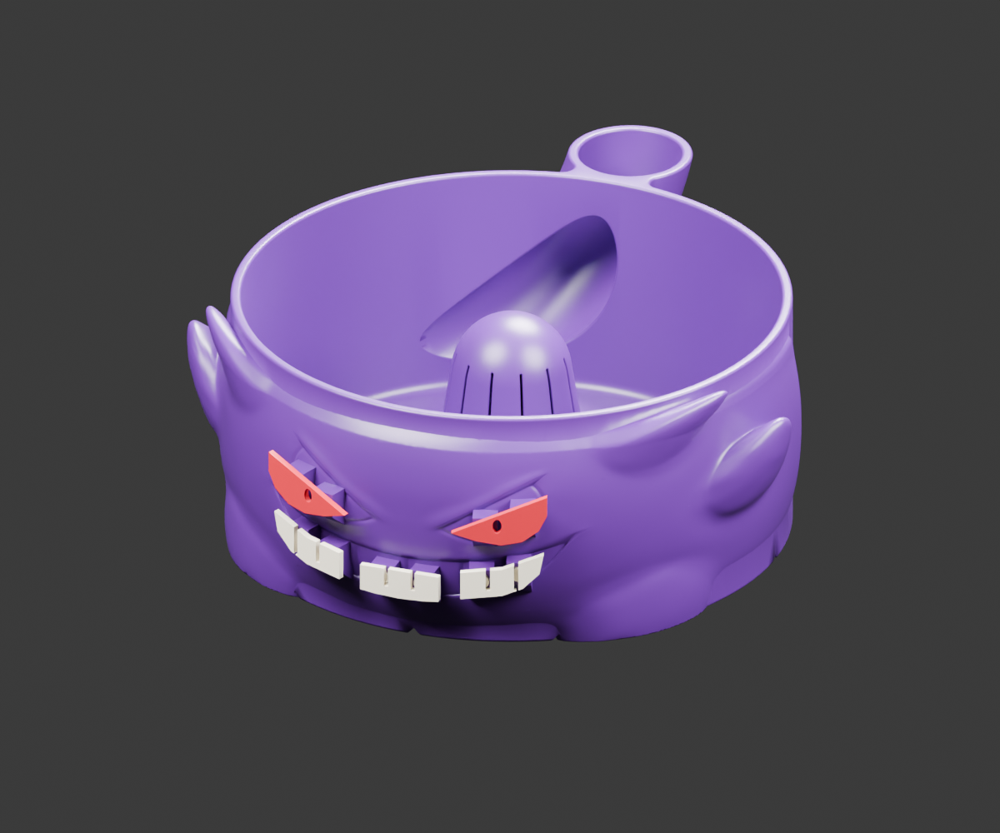
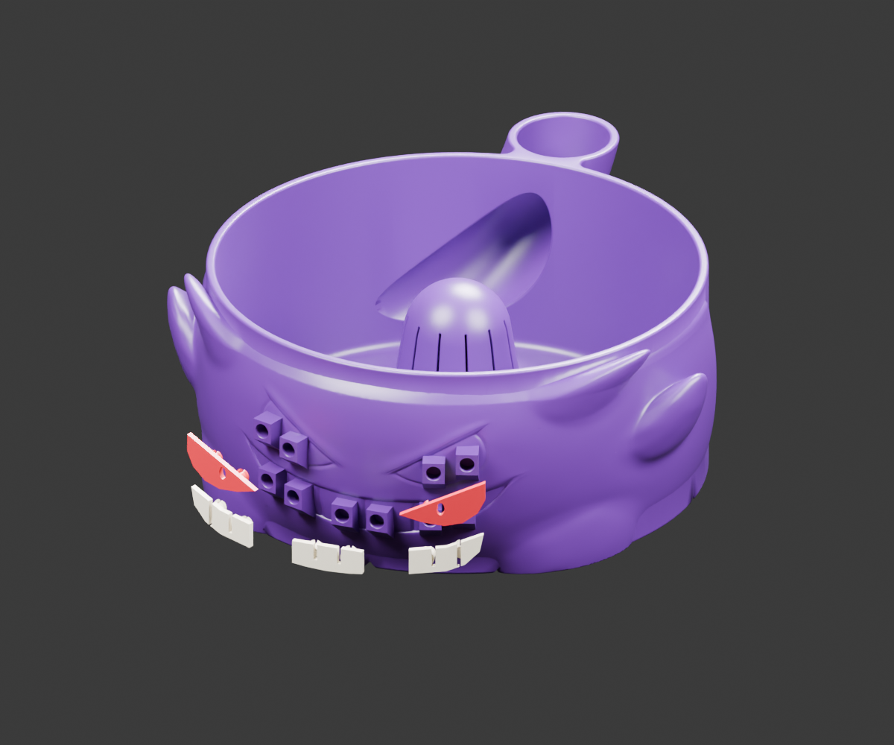

# Gengar FlowWash — snap-in detail kit

The latest version combines the FlowWash washing chamber with a slim Gengar exterior, **ten exterior sockets**, two red eye inserts, and three white grin inserts. Use this socketed bowl rather than any earlier socket-free version.

## Print these files

Open each file **as a project** in Bambu Studio. Select the filament matching your spool and confirm your build plate before slicing. Configured for the Bambu P1S with its standard 0.4 mm nozzle and PLA. No AMS required; change colours between jobs.

| Order | Project | Estimated time | PLA |
| --- | --- | --- | --- |
| 0 | [Fit test](00_Fit_test_P1S.3mf) | 11 min | 0.80 g |
| 1 | [Bowl WITH sockets](01_Bowl_P1S.3mf) | 2 h 33 min | 105.26 g |
| 2 | [Both red eyes](02_Red_eyes_P1S.3mf) | 10 min | 0.75 g |
| 3 | [Three white grin sections](03_White_grin_P1S.3mf) | 11 min | 0.98 g |

Times are Bambu Studio estimates, not measured print times. Print the fit test first: the mechanical snap fit has **not been physically tested**. Keep every part at 100% scale.

## Assembly

Each insert has two split pins. Push them into its matching pair of blind exterior sockets. The pins compress through the socket lip and expand inside the cavity. Pupil holes and tooth gaps expose the purple body. No glue is intended.

[Full printing and assembly instructions](START_HERE.txt) · [Editable Blender model](Gengar_Snap_Detail_Kit.blend)

## Verification

Meshes are connected and manifold. Seated insert/body surface-intersection checks passed. The washing chamber probes match the original FlowWash geometry. All four P1S projects sliced without warning messages or reported mesh repairs. Physical snap fit and water flow remain untested.

[Geometry checks](Geometry_checks.json) · [Slicing reports](Slicing_reports.json)

## Source credits

Built from user-supplied `FlowWash_Bowl.3mf` (metadata credits **Helena**) and `gengar_miska_9cm.3mf` (metadata credits **tom3Dmodel**). Both source files contain **Standard Digital File License** metadata. No new open-source license or redistribution grant is asserted for the source models or their derivatives.
