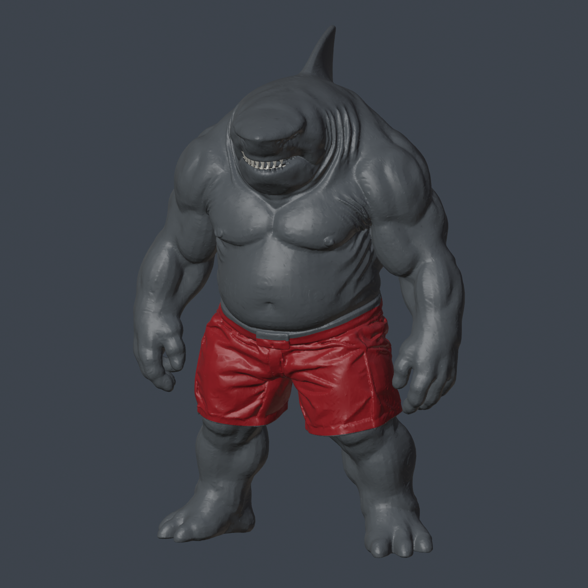

# King Shark — realistic 47 cm statue

[← Print gallery](../../README.md)

**469.54 mm tall × 323.27 mm wide × 237.93 mm deep.** Muscular King Shark fan statue with whole arms and lower legs, separate white dental arches, and keyed glue assembly. The current combination uses all-red shorts and faster legs/feet; the original body and its connectors stay unchanged.

**User-reported physical success: torso/chest and head.** The full files and revisions have digital geometry, slicing and plate checks. No physical print or fit result has been reported for the all-red replacement shorts, faster leg process, or complete revised assembly.

## Choose the files

| What you need | P1S project | P2S project |
|---|---|---|
| Original body, arms, fin and teeth; full historical v2 project | [Original v2 P1S](files/3mf/01_original_v2/King_Shark_Realistic_47cm_P1S_NON_AMS.3mf?raw=true) | [Original v2 P2S](files/3mf/01_original_v2/King_Shark_Realistic_47cm_P2S_NON_AMS.3mf?raw=true) |
| **Original dorsal fin by itself** — for the printed torso/back | [Fin-only P1S](files/3mf/04_fin_only/King_Shark_Original_Dorsal_Fin_ONLY_P1S_NON_AMS.3mf?raw=true) | [Fin-only P2S](files/3mf/04_fin_only/King_Shark_Original_Dorsal_Fin_ONLY_P2S_NON_AMS.3mf?raw=true) |
| **Recommended shorts: one all-red part** | [Red shorts P1S](files/3mf/02_all_red_shorts/King_Shark_ALL_RED_SHORTS_P1S.3mf?raw=true) | [Red shorts P2S](files/3mf/02_all_red_shorts/King_Shark_ALL_RED_SHORTS_P2S.3mf?raw=true) |
| **Recommended legs: both whole legs on one plate** | [Fast legs P1S](files/3mf/03_fast_legs_feet/FAST_BOTH_LEGS_P1S.3mf?raw=true) | [Fast legs P2S](files/3mf/03_fast_legs_feet/FAST_BOTH_LEGS_P2S.3mf?raw=true) |

For the fastest elapsed leg print using both machines, choose [left leg on P1S](files/3mf/03_fast_legs_feet/Two_printers/LEFT_LEG_P1S.3mf?raw=true) and [right leg on P2S](files/3mf/03_fast_legs_feet/Two_printers/RIGHT_LEG_P2S.3mf?raw=true) **instead of** either combined-leg project.

The dorsal fin is a separate part that glues onto the **center of the torso's upper back, behind the head**. In the original six-plate project it shares plate 4 with the old legs and shorts panels, so it can be missed when using the newer replacements. [See where it attaches and print only the fin](docs/FIN_ONLY.md).

Open the matching 3MF **as a project** and keep its custom process. No AMS is required. Use a standard 0.4 mm nozzle, calibrated PLA and the saved plate orientation/supports. Original full projects contain older shorts and leg layouts: do not print every variant or duplicate parts. Follow the [part-selection and assembly guide](docs/PRINTING_ASSEMBLY.md).

Already printed the chest/head? Keep it. The replacement shorts retain the exact waist-key and leg-socket core. The dark waistband is part of the unchanged torso. Skip the old `Shorts`, `Shorts_panel_L`, and `Shorts_panel_R` when using the replacement.

[Original STL geometry](files/stl/original_v2/) · [All-red shorts STL](files/stl/all_red_shorts/Shorts_ALL_RED.stl?raw=true) · [Fast-leg STL backups](files/stl/fast_legs_feet/) · [Editable all-red Blender assembly](source/all_red_shorts/King_Shark_all_red_shorts_47cm.blend?raw=true) · [Original Blender/source](source/original_v2/)

[**How this statue was made, from the approved image to printable parts**](docs/HOW_THIS_STATUE_WAS_MADE.md) records the generation settings, mesh repair, cuts, glue keys, print profiles and checks for another maker or agent.

STLs contain geometry only; they do not retain support settings, color assignments, infill, local joint reinforcement, or optimized print time. Prefer the printer-specific 3MF files.

## Support-inclusive estimates

| Edition | P1S | P2S | Material |
|---|---:|---:|---:|
| Original historical v2, all six plates | 38 h 31 min | 39 h 10 min | about 788 g |
| All-red replacement shorts only | 9 h 57 min | 10 h 07 min | about 218 g |
| Faster pair of legs/feet only | 5 h 33 min | 5 h 38 min | about 151 g |
| Original dorsal fin only | 51 min | 51 min | about 14 g |
| Legs split across P1S + P2S | about 2 h 55 min elapsed | simultaneous pair | about 151 g total |

These are Bambu Studio 02.08.02.61 estimates including supports and preparation, not measured completed-print times. The historical total is not a total for the recommended mixed revision. Faster legs save about 65 minutes (16.4%) against the original legs-only P1S benchmark. They use 0.28 mm layers, so printed layer lines are more visible than the original 0.20 mm profile.

## Validation and source

Preserved reports cover closed manifold meshes, STL roundtrips, embedded 3MF geometry, joint/insertion checks, P1S/P2S engine slicing, zero filament changes, and model/support/brim paths within the printer envelope. Publication staging copies the delivered artifacts without changing their geometry. [Current status](docs/VALIDATION_STATUS.md) explains historical report dates and user feedback; [copy inventory](validation/publication_copy_inventory.json) records SHA-256 hashes.

The mesh was generated through Microsoft TRELLIS.2 from the user-approved reference, then repaired and engineered locally. King Shark/Nanaue is an unofficial character interpretation, not an official film asset. No new blanket license or public redistribution permission is asserted. [Credits and provenance](CREDITS.md)

MakerWorld listing: not published. The existing GitHub repository is private; its visibility is unchanged.
