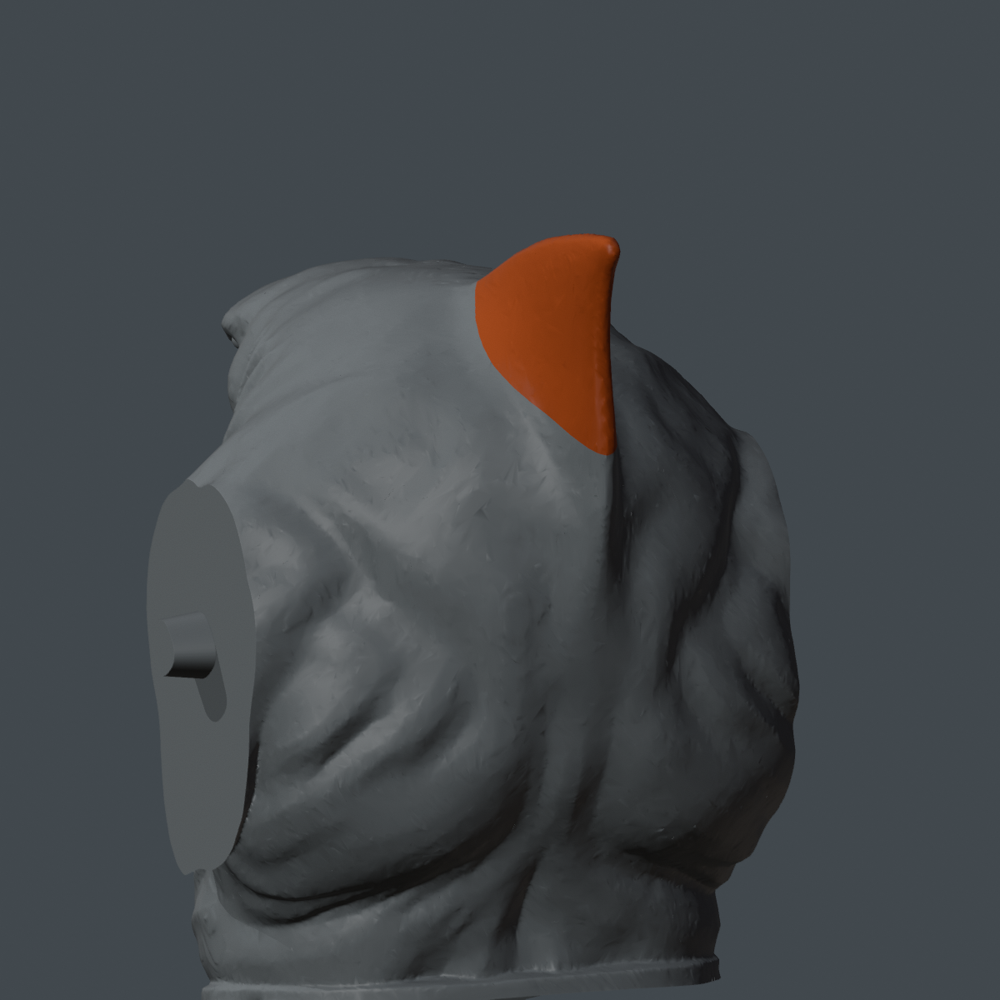

# The dorsal fin for the 47 cm King Shark body

[← Main statue files](../README.md)

The original statue's fin is a **separate glue-on part** called `Dorsal_fin`. Its socket fits the matching key on the **center of the torso's upper back, just behind the head**. The illustration highlights its location in orange; the one-color projects print it in gray/charcoal or black PLA. Joint `J05` has the original tapered glue fit with about 0.18 mm nominal root allowance. The fin geometry and torso geometry have not been scaled or reshaped.

## Print only the fin

- [Bambu P1S fin-only project](../files/3mf/04_fin_only/King_Shark_Original_Dorsal_Fin_ONLY_P1S_NON_AMS.3mf?raw=true)
- [Bambu P2S fin-only project](../files/3mf/04_fin_only/King_Shark_Original_Dorsal_Fin_ONLY_P2S_NON_AMS.3mf?raw=true)
- [Original dorsal fin STL](../files/stl/original_v2/Dorsal_fin.stl?raw=true)
- [Fin preview](../images/fin_only/fin_preview.png) · [plate layout](../images/fin_only/fin_plate.png) · [editable Blender fin](../source/fin_only/King_Shark_Original_Dorsal_Fin.blend?raw=true)

Open the matching 3MF **as a project**. It contains the exact original fin in the same print orientation as original plate 4, isolated on one plate. The fin-only export STL is byte-identical to the original `Dorsal_fin.stl` (SHA-256 `01f29d8a901a86d78268d0af8dbb54606f518a8c6cb60805dd4175c405e07b34`). The isolated plate uses 0.20 mm layers, three walls, 8% gyroid, a 3 mm brim, and generated support at its small overhangs. No AMS or color changes are needed.

| Printer | Estimated time | Filament |
|---|---:|---:|
| P1S | 51 min | 13.7 g |
| P2S | 51 min | 13.6 g |

The original full statue project also includes this exact fin on **plate 4**, mixed with old legs and shorts side panels. If you use the newer fast-leg and all-red shorts projects, print this fin-only project as well. If you already printed the original plate 4, keep that fin and skip this one.

After removing supports/brim from the socket, apply a little super glue to the hidden contact face and seat the fin on the torso's upper-back key. The fin-only edition and its fit have digital checks, but this separate print and glue assembly have not been physically tested. Do not cut off the torso key or enlarge the socket preemptively.

[Validation](../validation/fin_only/) · [Full assembly order](PRINTING_ASSEMBLY.md)
