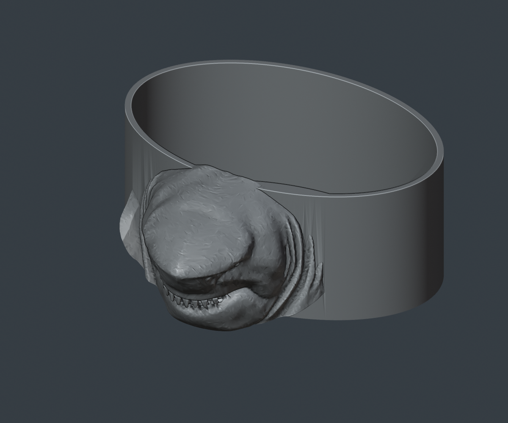

# King Shark catchall bowl

A compact, single-color bowl for keys, jewelry, earbuds, and small accessories. The face comes from the same King Shark sculpture whose chest/head the user printed successfully. This is an original homeware adaptation of that sculpt, with a smooth open cavity and a stable flat bottom.

## Print files

- [P1S project](files/3mf/King_Shark_Catchall_Bowl_P1S_NON_AMS.3mf)
- [P2S project](files/3mf/King_Shark_Catchall_Bowl_P2S_NON_AMS.3mf)
- [Upright STL](files/stl/King_Shark_Catchall_Bowl.stl)
- [Editable Blender source](source/King_Shark_Catchall_Bowl.blend)

Open the matching 3MF **as a project** to keep its settings. Use one gray filament; AMS is unnecessary. Print upright on the flat bottom, as arranged in the project. Remove the small generated supports around the facial overhangs after printing.

## Size and useful space

| Property | Value |
| --- | --- |
| Overall width × depth × height | 140 × 143.4 × 59.4 mm |
| Clear opening, approximately | 134.8 × 90.8 mm |
| Clear cavity height | 54.2 mm |
| Approximate cavity volume | 520 mL |
| Nominal liner wall | 2.6 mm |
| Verified uninterrupted minimum wall band | 2.4 mm |
| Flat floor | 2.8 mm |

The cavity is for accessories; the model has not been qualified for direct food contact or liquid containment.

## Slicer estimates

The supplied projects use a 0.4 mm nozzle, 0.28 mm layers, three walls, and an object override of 5% gyroid infill. These are slicer estimates, including generated supports, rather than measured print results.

| Printer | Total estimated time | Total filament | Support + interface printing time |
| --- | --- | --- | --- |
| Bambu P1S | 2 h 59 min | 113.3 g | 6 min 34 sec |
| Bambu P2S | 3 h 01 min | 113.2 g | 6 min 40 sec |

Support and interface extrusion account for approximately 2.43 g, calculated from the G-code using 1.75 mm filament and 1.24 g/cm³. This support-only figure excludes brim and startup purge. The total filament figures above come directly from the slicer.

## Validation

- One connected, outward-facing, watertight manifold solid.
- Binary STL export was reopened and verified; no geometry repair is required on import.
- A full 2.4 mm wall band and 2.8 mm floor remain intact; the cavity obstruction check is zero.
- Both projects sliced successfully with empty plate warning messages and zero filament changes.
- Checked 261,451 P1S extrusion segments and 265,607 P2S extrusion segments, including arcs, model, supports, and brim. Every checked path is inside the build volume; none enters the P1S excluded corner.
- Actual-mesh renders were inspected. This bowl has **not yet been physically printed**.

See [geometry validation](validation/engineering_validation.json), [print validation](validation/print_validation_summary.json), and [change history](docs/CHANGELOG.md).

## Editing and future revisions

`build_bowl.py` reconstructs the model from the existing King Shark torso and dental arches; `render_bowl.py` renders the resulting geometry. The original statue files are unchanged. Future geometry or settings changes should be recorded in `CHANGELOG.md`, followed by STL reimport, both printer slices, and toolpath checks. Keep dimensions, support settings, and estimates in this document synchronized with the delivered projects.

See [agent handoff](../../docs/character-homeware/AGENT_HANDOFF.md), [source notes](source/README.md), and [credits](CREDITS.md).
