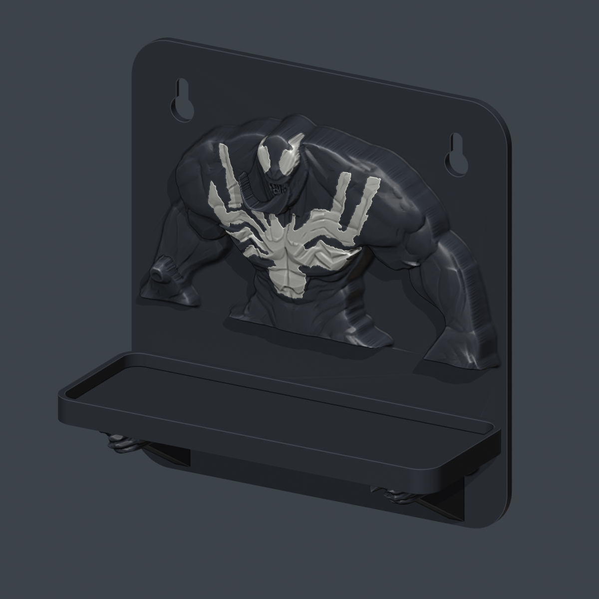

# Venom accessory shelf

[← Print gallery](../../README.md)

A compact character relief with a shallow tray for keys, earbuds or a small collectible. It uses black character/back and tray, with three separate white eye/chest inserts. The sculpt is adapted from the existing statue, with compressed depth and simplified contours to keep printing practical. It is a **new, physically untested prototype**.

## Download and print

- [P1S non-AMS project](files/3mf/Venom_Shelf_P1S_NON_AMS.3mf?raw=true)
- [P2S non-AMS project](files/3mf/Venom_Shelf_P2S_NON_AMS.3mf?raw=true)
- [Individual STLs](files/stl/)
- [Editable Blender scene](source/Venom_Shelf.blend?raw=true)

Open the matching 3MF **as a project**. Each plate uses one color; change the spool between plates. Standard 0.4 mm nozzle, PLA, 0.28 mm main layers, three walls, 8% gyroid, four top/bottom layers with 1.12 mm minimum thickness. The white inserts use 0.16 mm object layers. Both the character back and tray print flat. Generated support is disabled; their orientation avoids major undercuts. The supplied slicer checks do not establish physical print quality or load capacity.

| Printer | Estimated total time | Filament | Plates |
|---|---:|---:|---:|
| P1S | 4 h 35 min | 138.7 g | 2 |
| P2S | 4 h 37 min | 138.5 g | 2 |

These are Bambu Studio 02.08.02.61 estimates, including preparation. Different calibrated filament or cooling settings can change them. [Per-plate data](validation/slicer_estimates.json)

## Dimensions and assembly

Overall assembled envelope: **150 mm wide × 58.2 mm projection × 156 mm high**. The mounting back is 148 × 156 mm; the tray is 150 × 55 mm, with a 4.2 mm floor and 4.8 mm raised lip. Two 6 mm gussets carry the tray; registration keys locate it with 0.22 mm nominal side clearance. There is no flexible snap latch.

Remove brims and clean the mating surfaces. Approach from the front with the tray 16 mm above its seated position, slide it toward the backplate, then lower it over both locating keys. Bond the broad gusset seats and back contact with a suitable plastic adhesive; let it cure before handling. The white inserts fit their matching pockets from the front; use a small amount of glue and keep the eyes in their left/right positions. See the [exploded assembly](images/exploded.png). Fit and assembly have been checked geometrically, not physically.

## Mounting

The rear is flat at Y=0 with two nominal 25 × 100 mm clear pad zones. **3M does not recommend picture-hanging strips for shelves**, so this model has no assigned adhesive load rating. See the [official guidance](https://multimedia.3m.com/mws/media/1792217O/command-a-online-content-file-picture-hanging-strips-en.pdf) and [mounting research](../../docs/character-homeware/MOUNTING_RESEARCH.md).

Two visible keyhole slots provide a screw-mounting alternative: 108 mm center spacing, 9.2 mm entry diameter and 4.7 mm neck width. Choose hardware appropriate to the wall and check the printed slots. The keyholes, glue joint, material and wall attachment have **not been load-tested**; no safe working load is claimed. Do not use a picture-strip weight label as a shelf rating. For a no-screw version with an established manufacturer rating, a later design can surround a rated ledge after its dimensions are measured.

## Checks and files

Closed manifold solids; actual float32 STL reimport and embedded 3MF geometry checked; assembly overlaps and tray insertion sampled; both printers sliced successfully with empty plate warning messages and no filament changes. Extrusion paths include brims and stay inside the compatible build envelope. Read [validation](validation/), [source notes](source/README.md), [credits](CREDITS.md), and [agent handoff](../../docs/character-homeware/AGENT_HANDOFF.md).

This shelf does not change the successful large statue or its connectors. No physical print, mounting or load test has been completed for this shelf.
