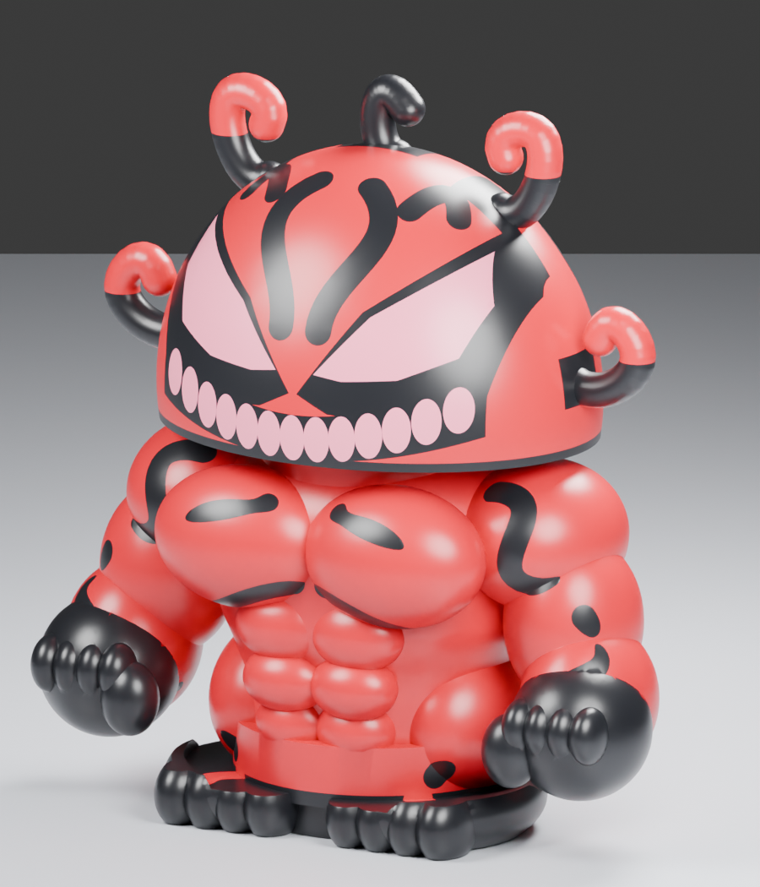

# Puffco character cases — Venom

**Current completed release: Venom V4 Fast**, built around the complete original `Core_Case.3mf`. The original body and lid are preserved at 100% scale. **Hulk is a pending design request, not a finished model.**

Start with [the agent handoff](Docs/AGENT_HANDOFF.md) for project context or [printing instructions](Docs/PRINTING.md) to print.

| Folder | Purpose |
|---|---|
| `Foundations/` | Original `Core_Case.3mf`, exact extracted meshes and source inspection |
| `Print/FullColor/` | Latest optimized red/black/pink Bambu Studio projects — recommended |
| `Print/SingleColor/` | Optional faster red body/head and black feet; contrasting details absent |
| `Print/Geometry/` | Exact V4 unsliced geometry and assembled review model |
| `CAD/` | Editable Blender model, Python generators, parameters and export/slice scripts |
| `Profiles/` | P1S 0.4 mm benchmark configuration and generic PLA assumptions |
| `Previews/` | Renders of actual V4 geometry |
| `Reports/` | Geometry checks, source preservation and measured slicer estimates |
| `Docs/` | Printing, design, agent handoff and pending Hulk brief |

The Desktop delivery is `C:\Users\george\Desktop\Prints\Venom`. It contains only current print projects, previews, instructions and `Foundations/Core_Case.3mf`. The repository is the authoritative editable project.

Full-color estimate: **39 h 44 m**, compared with **48 h 48 m** for the baseline. Optional single-color estimate: **11 h 16 m**. These are controlled Bambu Studio estimates, not real print measurements. Select calibrated filament profiles and re-slice before printing.

Original case attribution: **ROADBLOCK**, “Core Case for Puffco Proxy Core.” Preserve the source file and its metadata. Its embedded license is MakerWorld Exclusive License; no redistribution permission is asserted here.

Older Venom folders and development clutter were moved intact into the local ignored `_archive/2026-09-26_cleanup/` folder. Unrelated Desktop print projects were not changed. See [cleanup inventory](Docs/CLEANUP.md).
