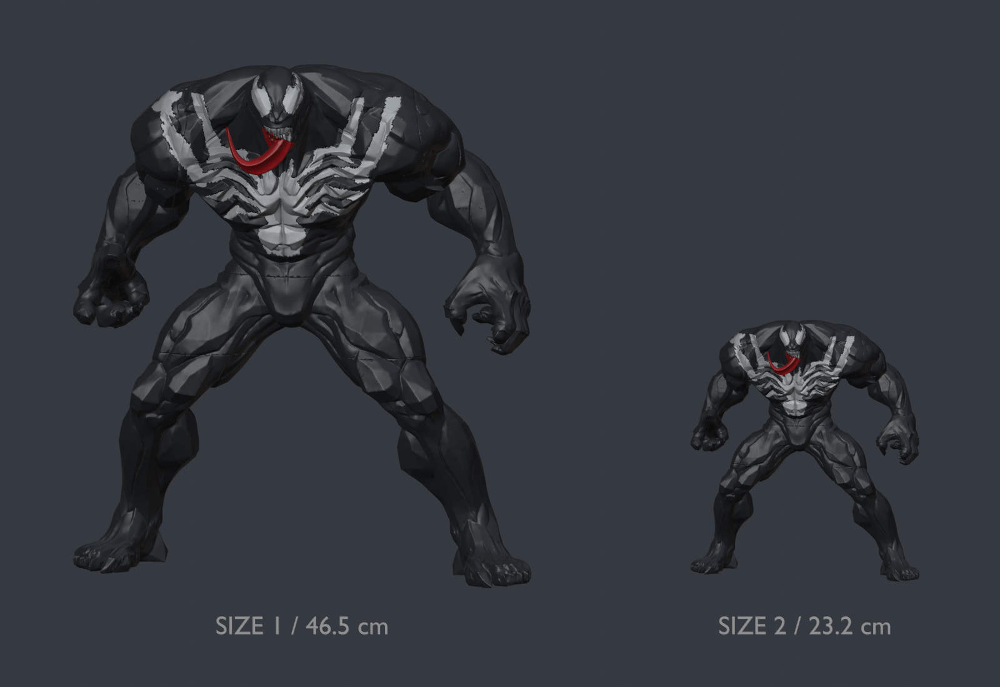

# Venom muscular shelf statue — two sizes

[← Print gallery](../../README.md)

**Size 1: 46.5 cm. Size 2: 23.2 cm.** Original pose and muscle proportions retained, with the floating shoulder/back tendrils removed. Whole arms and legs, keyed glue assembly, white accents and red tongue. Choose separate-color parts for lower waste, or the small AMS edition for fewer pieces to glue.

**Recommended for efficiency: Size 2 SEPARATE.** On the P1S it uses about 171 g and 10 h 11 min, including support and preparation. AMS reduces plate changes and white-insert assembly, but increases printing time and material substantially.

## Downloads

| Edition | P1S project | P2S project | STL bundle |
|---|---|---|---|
| Size 1 / 464.74 mm / separate colors | [P1S 3MF](Size_1_465mm/Venom_Size1_P1S_SEPARATE.3mf?raw=true) | [P2S 3MF](Size_1_465mm/Venom_Size1_P2S_SEPARATE.3mf?raw=true) | [12 STLs](Size_1_465mm/Venom_Size1_STL_parts.zip?raw=true) |
| Size 2 / 232.37 mm / separate colors | [P1S 3MF](Size_2_232mm/Venom_Size2_P1S_SEPARATE.3mf?raw=true) | [P2S 3MF](Size_2_232mm/Venom_Size2_P2S_SEPARATE.3mf?raw=true) | [12 STLs](Size_2_232mm/Venom_Size2_STL_parts.zip?raw=true) |
| Size 2 / 232.37 mm / AMS | [P1S AMS 3MF](Size_2_232mm/Venom_Size2_P1S_AMS.3mf?raw=true) | [P2S AMS 3MF](Size_2_232mm/Venom_Size2_P2S_AMS.3mf?raw=true) | Use 3MF to preserve color/material regions |

[Size 1 Blender source](source/Venom_Size1_Blender.zip?raw=true) · [Size 2 AMS Blender source](source/Venom_Size2_AMS_Blender.zip?raw=true) · [Printing and assembly](docs/PRINTING_ASSEMBLY.md) · [Per-plate estimates](validation/Plate_estimates.csv)

Open a 3MF **as a project** and keep its custom process settings. Files contain full geometry, colors, support settings, sparse infill, and local joint reinforcement. A plain STL cannot carry those settings. All dimensions are millimeters. Use 0.4 mm standard-flow nozzle, PLA and Textured PEI; select your actual calibrated filament before slicing. Black = slot 1, white = slot 2, red = slot 3.

## Slicer estimates

| Edition | Printer | Plates | Total estimated time | Total filament | Color changes |
|---|---|---:|---:|---:|---:|
| Size1 separate | P1S | 8 | 37 h 58 min | 772.2 g | 0 |
| Size1 separate | P2S | 8 | 38 h 39 min | 771.7 g | 0 |
| Size2 separate | P1S | 4 | 10 h 11 min | 171.0 g | 0 |
| Size2 separate | P2S | 4 | 10 h 26 min | 170.8 g | 0 |
| Size2 AMS | P1S | 2 | 28 h 11 min | 461.9 g | 532 |
| Size2 AMS | P2S | 2 | 26 h 40 min | 458.5 g | 532 |

Times include preparation; material includes supports and, for AMS, purge and prime tower. These are Bambu Studio 02.08.02.61 estimates, not measured completed-print results. Reslicing with different filament, printer firmware/profile, cooling, supports, or speed settings can change them.

## Assembly and fit

Separate-color editions have twelve pieces. The AMS edition has seven assembly pieces: white details are integrated into the torso and right arm, while the tongue remains a red piece. Arms and legs remain whole. The torso is continuous in all these editions.

Six asymmetric tapered glue joints keep 0.18 mm nominal radial allowance; separate white inserts keep about 0.20 mm allowance. Size 2 receiving cavities were adjusted after scaling so the clearances did not shrink to half size. These are glue joints in the style of the Buu reference, not exact Buu copies or flexible snap clips. A fit coupon is optional. No physical fit or invisible-seam guarantee is implied.

## Verification and source

Closed manifold meshes, colors and embedded geometry checked. Small STL exports reloaded and checked. Every project was sliced for its named printer. Small model/support/brim/prime-tower extrusion paths fit the bed, and P1S paths avoid its excluded front-left corner. Bambu Studio GUI imports checked for the full-size P1S and small P2S AMS editions, including custom presets and colors. **Physical print and assembly testing of these modified editions remain pending.**

Original sculpture: **OVERRIDE3D_5884368**, source title **Venom Marvel Rivals (Exclusive)**. George Dayoub directed the AI-assisted print preparation and modifications. See [credits and original license](CREDITS.md).

This upload is a **private project backup**. The source 3MF specifies **Standard Digital File License**; public redistribution permission has not been established. No new license is granted to the source sculpture, and no MakerWorld listing has been published. A [listing draft](docs/MAKERWORLD_DRAFT.md) is included for use only after that permission is established.
